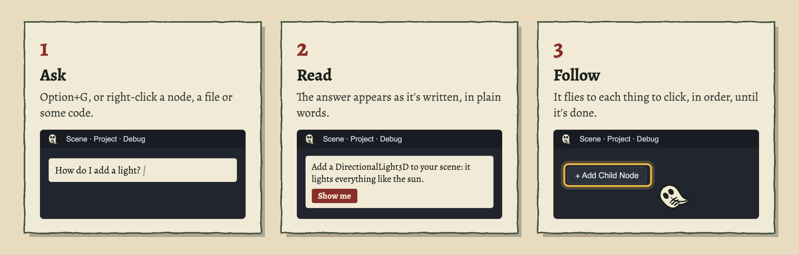

# Knochengeist for Godot

**Status:** beta, on Mac. Windows and Linux are planned.

You're in the Godot editor, you can't find where something lives or how to make it, and the docs are in another window. Knochengeist puts a ghost in the editor's toolbar. Ask it in plain words, read the answer as it's written, then press Show me and it flies to each thing to click, in order, until it's done.

It answers through your own Claude Code, so it has no account, key or server of its own.

## What you need

- **Godot 4.6 or newer.** It's built and tested on 4.7.
- **A Mac or Linux.** Windows is next.
- **Claude Code**, installed and signed in with your Claude plan. Install it from [claude.com/claude-code](https://claude.com/claude-code), then open a terminal, type `claude` and sign in once. It's the only AI the helper uses today; Codex (ChatGPT plans) is next.

Each question is one Claude Code run, so it counts toward your plan's usage like any other. If you sign Claude Code in with an API key instead of a plan, each question is billed to that key.

## Install

1. Download `knochengeist-helper-<version>.zip` from the [latest release](https://github.com/Eldriss-Studio/knochengeist-helper/releases/latest), unzip it, and copy its `addons/kg_helper` folder into your project's `addons` folder (make `addons` if your project has none).
2. In Godot, open Project > Project Settings > Plugins and turn on **Knochengeist helper**.

The ghost appears in the toolbar. It checks that Claude Code is installed and signed in, without making Godot wait.

## Updating

When a newer version is out, the ghost's menu shows **Update to version…**. It opens what's new; **Update** replaces the helper's folder in one go, then asks you to reload the project. If anything goes wrong, nothing changes. The helper checks once a day, and never updates on its own. Turn the check off in Settings, under Updates.

## Asking

- Press **Option+G**, or click the ghost and pick **Ask the ghost**. Type your question and press Enter.
- The answer appears as it's written. If it involves clicks, **Show me** appears: press it and the ghost points at the first thing to click, then the next, until it's done. Press Esc to stop it pointing.
- **Follow up** in the box at the bottom of the answer: the ghost remembers the conversation until you close the card. **Recent questions**, in the ghost's menu, shows your last five answers again without asking Claude Code.
- **When your game hits an error**, the ghost offers to explain it. Click the offer, or pick **Explain the last error** in its menu, and the card opens ready to ask, with the error and the script lines around it. Nothing is sent until you press Ask.
- It answers in the language your Godot editor is set to, and names buttons the way your editor shows them.
- **Right-click to ask about something:** in the Scene dock, the FileSystem dock, the Inspector or the script editor, choose **Ask the ghost about this**. The card opens with a question about what you picked, ready to send or change. In the script editor, it asks about the lines you selected.
- The first time you ask in a project, a window says exactly what the helper sends and asks you to allow it (see [What it sends](#what-it-sends)).

## The ghost's menu

Past 80% of your Claude plan's limit, the ghost in the toolbar wears a ring filled to how much is used, and its tooltip says when it resets.

Click the ghost, or open Project > Tools > Knochengeist. The first lines say where answers come from right now: your Claude plan (or that questions are billed to your API key), how much of its limit is used and when it resets, and where your Claude Code is. Under them:

- **Ask the ghost**, with its keys. The keys are a Godot editor shortcut: change them in Editor Settings > Shortcuts, under `knochengeist`, and the menu names whatever you picked.
- **Settings…**: your AI (the plan, whether you're signed in, and how much of its limit is used), which Claude Code to run, if it isn't in a usual place, and which model to ask (Sonnet, Fable, Opus or Haiku; Fable and Opus use up your plan's limit faster), Reduce motion, which makes the ghost appear where it points instead of flying there, and Check for updates. They're saved in Editor Settings under `knochengeist/`, so they show there too.
- **Show log**: the helper's log, one line for each check and each question that went wrong, with Claude Code's own words. It's kept small, in the project's user data folder.
- **Copy debug info…**: shows, then copies, what someone needs to look into a problem: the helper and Godot versions, your system, which Claude Code and its version, and how it's signed in. Never a token.
- **About Knochengeist**: the helper's version, with a link to what it sends.

## What it sends

Before it runs Claude Code for the first time in a project, the helper asks, with this text:

> To answer, Knochengeist runs your Claude Code on this computer.
>
> Each question sends to Anthropic, using your account:
> - your question
> - the open scene's file name and the selected node
> - the names of what's on your screen in Godot: buttons, nodes in the Scene dock, files and folders in lists, Inspector properties and hints in text boxes
> - during a walk-through, what you clicked and typed in the boxes it pointed at
> - when you ask about something you right-clicked: its name, or the code you selected
> - in a follow-up, your last few questions and answers in that conversation
> - when your question names something in Godot, its reference pages from your own Godot
> - when you ask about an error from your game: its text and the script lines around it
>
> It never sends passwords, stores no logins, and sends nothing else.
>
> Separately, once a day it asks GitHub whether a newer helper is out. Turn that off in Settings.

Your answer is kept for that project, outside its folder, and it asks again if a different Claude Code would run.

- It runs your own, unmodified `claude`, signed in by you. It never reads, stores or sends your login.
- It starts it with your personal Claude settings, plugins and MCP servers left out (`--setting-sources "" --strict-mcp-config`) and its tools turned off, so it can only answer: it can't change your project or run commands.
- It stops it when you close the card or Godot.
- Besides that, the helper only asks GitHub once a day whether a newer version is out, downloads Godot's manual for your Godot version from GitHub once, and collects no usage data.
- It keeps your answers, and whether you said they helped, in the project's user data folder, so you can include the ones that didn't help when you report a problem. Turning the helper off deletes them.
- It keeps a searchable copy of Godot's class reference, built from your own Godot and kept in the project's user data folder. Turning the helper off deletes it. The class reference is part of the Godot Engine (MIT), by Juan Linietsky, Ariel Manzur and contributors.

## When something's wrong

The ghost is dimmed when it can't answer, and the first line of its menu says why, with the fix:

| The menu says | What to do |
|---|---|
| Claude Code not found | **Install Claude Code…** opens its page. Install it, then come back to Godot: it checks again. |
| Not signed in to Claude Code | **Sign in to Claude Code…** opens Terminal running `claude`. Sign in there, then come back to Godot. |
| No Claude Code at the path in Settings | Open **Settings…** and use Change… to pick `claude`, or Find automatically. |

On the card:

- **"You've used all of your Claude plan's weekly limit. It resets in…"**: wait until then. The ghost warns you once when you're close.
- **"That didn't work"**: press Ask again. If it keeps happening, open **Show log** to see what Claude Code said, and use **Copy debug info…** when you report it.

## Turning it off

Turn it off in Project > Project Settings > Plugins. That removes its shortcut, its log and the files it kept in the project's user data, and forgets that you allowed it to run Claude Code here. Your Claude Code path and model stay in Editor Settings, under `knochengeist/`, in case you turn it on again. To remove it completely, also delete the `addons/kg_helper` folder.

## With the Knochengeist course

If you're taking a Knochengeist course and its course page is running on this computer, the helper answers through the course page instead. That adds your lesson and progress, and the course page's "Show me in Godot". Without the course page, it works on its own as described above.

## Questions

**Why "Knochengeist"?** It's German for "bone ghost": you can see its bones through it.

**Can it change my project?** No. Claude Code runs with its tools turned off, so it can only answer. Every click is yours; the ghost only shows where.

**Where do I report a problem?** In this repo's [Issues](https://github.com/Eldriss-Studio/knochengeist-helper/issues). Paste what **Copy debug info…** shows: it has the versions and how Claude Code is set up, never a token.

## Versions

| Helper version | Godot |
|---|---|
| 42 | 4.6 and newer (tested on 4.7) |
| 41 | 4.6 and newer (tested on 4.7) |
| 40 | 4.6 and newer (tested on 4.7) |
| 39 | 4.6 and newer (tested on 4.7) |
| 38 | 4.6 and newer (tested on 4.7) |
| 37 | 4.6 and newer (tested on 4.7) |
| 36 | 4.6 and newer (tested on 4.7) |
| 35 | 4.6 and newer (tested on 4.7) |
| 34 | 4.6 and newer (tested on 4.7) |
| 33 | 4.6 and newer (tested on 4.7) |
| 32 | 4.6 and newer (tested on 4.7) |
| 31 | 4.6 and newer (tested on 4.7) |
| 30 | 4.6 and newer (tested on 4.7) |
| 29 | 4.6 and newer (tested on 4.7) |
| 28 | 4.6 and newer (tested on 4.7) |
| 27 | 4.6 and newer (tested on 4.7) |
| 26 | 4.6 and newer (tested on 4.7) |
| 25 | 4.6 and newer (tested on 4.7) |
| 24 | 4.6 and newer (tested on 4.7) |

What changed in each version is in [CHANGELOG.md](CHANGELOG.md). The helper is MIT licensed ([LICENSE](LICENSE)). The Godot manual pages it reads are the [Godot Engine documentation](https://docs.godotengine.org) by Juan Linietsky, Ariel Manzur and the Godot community, [CC BY 3.0](https://creativecommons.org/licenses/by/3.0/), split into sections by `tools/manual_index.py`.

## For developers

The helper is plain GDScript in `addons/kg_helper/`, with the prompts it asks with in `addons/kg_helper/prompts/`. It's built and tested alongside the Knochengeist course, whose tests run it in real headless Godot against stand-ins for Claude Code and for the person using it. Report problems in this repo's [Issues](https://github.com/Eldriss-Studio/knochengeist-helper/issues), with what **Copy debug info…** shows.
