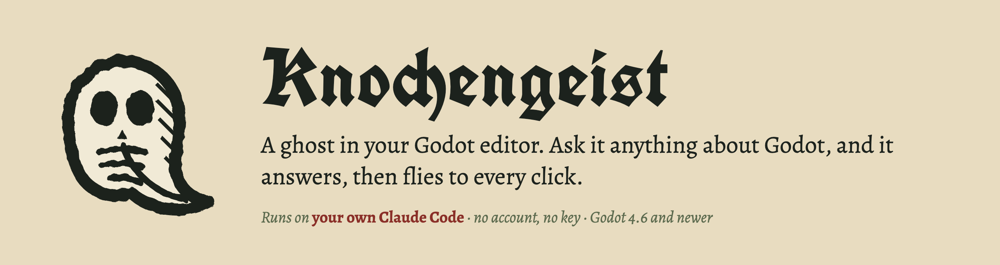

# Knochengeist for Godot

**Status:** beta, on Mac, Linux and Windows.

You're in the Godot editor, you can't find where something lives or how to make it, and the docs are in another window. Knochengeist puts a ghost in the editor's toolbar. Ask it in plain words, read the answer as it's written, then press Show me and it flies to each thing to click, in order, until it's done.

It answers through your own AI tool (Claude Code, Codex or GitHub Copilot), so it has no account, key or server of its own.

## What you need

- **Godot 4.6 or newer.** The helper is built on 4.7. Each release is checked to load with no errors or warnings on 4.6 and 4.7.
- **A Mac, Linux or Windows.**
- **Any editor language.** The helper follows your editor's language: the menu, cards, Settings and messages come in Brazilian Portuguese and Spanish when Godot is set to them, and English otherwise. Translations live in `addons/kg_helper/locale/`; a new language is one `.po` file made from `kg_helper.pot`.
- **An AI tool you're signed in to**, picked under **AI tool** in Settings. If it isn't installed yet, **Install…** in Settings (or the ghost's menu) runs its own installer in a terminal:
  - **Claude Code**, with a Claude plan. Install it from [claude.com/claude-code](https://claude.com/claude-code), then open a terminal, type `claude` and sign in once.
  - **Codex**, with a ChatGPT plan. The ChatGPT app for Mac comes with it, and the helper finds it there. Otherwise install it with `curl -fsSL https://chatgpt.com/codex/install.sh | sh` (or `brew install --cask codex`), then run `codex login` once in a terminal.
  - **Copilot**, with any GitHub Copilot plan, Free included. Install it with `curl -fsSL https://gh.io/copilot-install | bash`, `brew install --cask copilot-cli` or `winget install GitHub.Copilot`, then run `copilot login` once in a terminal.

Each question is one run of that tool, so it counts toward your plan's usage like any other. With an API key instead of a plan, each question is billed to that key (Claude Code and Codex). Codex and Copilot answer all at once rather than word by word, and don't report how much of the plan is left; Claude Code does. Copilot runs with a settings folder of its own, so the helper's questions stay out of your Copilot history. It uses your own sign-in: the helper copies only your account name there, never your token. It can't check that sign-in without spending a request, so your first question finds out.

## Install

1. Download `knochengeist-helper-<version>.zip` from the [latest release](https://github.com/Eldriss-Studio/knochengeist-helper/releases/latest), unzip it, and copy its `addons/kg_helper` folder into your project's `addons` folder (make `addons` if your project has none).
2. In Godot, open Project > Project Settings > Plugins and turn on **Knochengeist helper**.

The ghost appears in the toolbar. It checks that your AI tool is installed and signed in, without making Godot wait.

## Updating

When a newer version is out, the ghost's menu shows **Update to version…**. It opens what's new; **Update** replaces the helper's folder in one go, then asks you to reload the project. If anything goes wrong, nothing changes. The helper checks once a day, and never updates on its own. Turn the check off in Settings, under Updates.

## Asking

- Press **Option+G**, or click the ghost and pick **Ask the ghost**. Type your question and press Enter.
- The answer appears as it's written. If it involves clicks, **Show me** appears: press it and the ghost points at the first thing to click, then the next, until it's done. Press Esc to stop it pointing.
- **Follow up** in the box at the bottom of the answer: the ghost remembers the conversation until you close the card. **Recent questions**, in the ghost's menu, shows your last five answers again without asking your AI tool.
- **When your game hits an error**, the ghost offers to explain it. Click the offer, or pick **Explain the last error** in its menu, and the card opens ready to ask, with the error and the script lines around it. Nothing is sent until you press Ask.
- It answers in the language your Godot editor is set to, and names buttons the way your editor shows them.
- **Right-click to ask about something:** in the Scene dock, the FileSystem dock, the Inspector or the script editor, choose **Ask the ghost about this**. The card opens with a question about what you picked, ready to send or change. In the script editor, it asks about the lines you selected. On Godot 4.6, the Inspector has no right-click entry.
- The first time you ask in a project, a window says exactly what the helper sends and asks you to allow it (see [What it sends](#what-it-sends)).

## The ghost's menu

With Claude Code, past 80% of your Claude plan's limit, the ghost in the toolbar wears a ring filled to how much is used, and its tooltip says when it resets. Codex and Copilot don't report usage, so the ring stays hidden with them.

Click the ghost, or open Project > Tools > Knochengeist. The first line says which AI tool is answering right now, or what's wrong with it. Under it: your plan (or that questions are billed to your API key) and, with Claude Code, how much of its limit is used and when it resets. Then:

- **Ask the ghost**, with its keys. The keys are a Godot editor shortcut: change them in Editor Settings > Shortcuts, under `knochengeist`, and the menu names whatever you picked.
- **Settings…**:
  - **AI tool**: Claude Code, Codex or Copilot, each with the plan it runs on. Picking one checks it at once and says whether it's installed and signed in, with an **Install…** or **Sign in…** button when it isn't.
  - **Model**: with Claude Code, Sonnet, Fable, Opus or Haiku (Fable and Opus use up your plan's limit faster). Codex and Copilot choose their own model, so there's nothing to pick.
  - **Effort**: how long the AI thinks before answering, with Claude Code and Codex. Low (the default) answers soonest; High thinks longest. Copilot decides this itself.
  - **Location**: where the tool is, with **Choose file…** to pick it yourself or **Find automatically**.
  - **Godot docs**, **Motion** (Reduce motion makes the ghost appear where it points instead of flying there) and **Updates** (Check for updates).

  They're saved in Editor Settings under `knochengeist/`, so they show there too.
- **Show log**: the helper's log, one line for each check and each question that went wrong, with your AI tool's own words. It's kept small, in the project's user data folder.
- **Copy debug info…**: shows, then copies, what someone needs to look into a problem: the helper and Godot versions, your system, which AI tool and its version, and how it's signed in. Never a token.
- **About Knochengeist**: the helper's version, with a link to what it sends.

## What it sends

Before it runs your AI tool for the first time in a project, the helper asks, with this text. It names the tool and company you picked: Claude Code and Anthropic, Codex and OpenAI, or Copilot and GitHub. Here it's shown for Claude Code.

> To answer, Knochengeist runs the AI tool you picked in Settings, Claude Code, on this computer.
>
> Each question goes to Anthropic, with your account. It sends:
> - your question
> - the open scene's file name and the selected node
> - the names of what's on your screen in Godot: buttons, nodes in the Scene dock, files and folders in lists, Inspector properties and hints in text boxes
> - during a walk-through, what you clicked and typed in the boxes it pointed at
> - when you ask about something you right-clicked: its name, or the code you selected
> - in a follow-up, your last few questions and answers in that conversation
> - when your question names something in Godot, its reference pages from your own Godot
> - when you ask about an error from your game: its text and the script lines around it
>
> It never sends your password or sign-in, and it sends nothing else.
>
> Separately, once a day it asks GitHub whether a newer helper is out (turn that off in Settings), and once per Godot version it downloads Godot's manual from GitHub.

Your answer is kept for that project, outside its folder, and it asks again if a different tool would run.

- It runs your own, unmodified tool, signed in by you. It never reads, stores or sends your login.
- It starts the tool with its tools turned off, so it can only answer: it can't change your project or run commands. How, for each:
  - **Claude Code**: `--tools=` turns every tool off, and your settings, plugins and MCP servers are left out (`--setting-sources=`, `--strict-mcp-config`).
  - **Codex**: `codex exec --json` with its shell off, web search off and a read-only sandbox. Your Codex config is ignored, and no session is saved.
  - **Copilot**: `--available-tools=` leaves it no tools, and shell, write, read and url are denied. Your custom instructions and the built-in MCP servers are off. It runs with a settings folder of its own, where only your account name is copied, and session sync is off.
- It stops it when you close the card or Godot.
- Besides that, the helper only asks GitHub once a day whether a newer version is out, downloads Godot's manual for your Godot version from GitHub once, and collects no usage data.
- It keeps your answers, and whether you said they helped, in the project's user data folder, so you can include the ones that didn't help when you report a problem. Turning the helper off deletes them.
- It keeps a searchable copy of Godot's class reference, built from your own Godot and kept in the project's user data folder. Turning the helper off deletes it. The class reference is part of the Godot Engine (MIT), by Juan Linietsky, Ariel Manzur and contributors.

## When something's wrong

The ghost is dimmed when it can't answer, and the first line of its menu says why, with the fix. `<tool>` is the AI tool you picked:

| The menu says | What to do |
|---|---|
| `<tool>` not found | **Install `<tool>`…** in the menu, or **Install…** in Settings, runs its own installer in a terminal. Come back to Godot: it checks again. |
| Not signed in to `<tool>` | **Sign in to `<tool>`…** opens a terminal running its sign-in: `claude`, `codex login` or `copilot login`. Sign in there, then come back to Godot. |
| `<tool>` isn't at the file you chose | Open **Settings…** and use **Choose file…** to pick it again, or **Find automatically**. |
| `<tool>` won't start | Open **Show log** to see what it said, and use **Copy debug info…** when you report it. |

Copilot can't be checked for sign-in without spending a request, so it's only found out signed out on your first question.

On the card, when you reach your plan's limit:

- **Claude Code:** "You've used all of your Claude plan's weekly limit. It resets in…". Wait until then. The ghost warns you once when you're close.
- **Codex:** "You've reached your ChatGPT plan's usage limit for Codex. Try again later."
- **Copilot:** "You've used all of your Copilot plan for now. Wait a bit, then ask again."

And for any tool, **"That didn't work"**: press Ask again. If it keeps happening, open **Show log** to see what the tool said, and use **Copy debug info…** when you report it.

## Turning it off

Turn it off in Project > Project Settings > Plugins. That removes its shortcut, its log and the files it kept in the project's user data, and forgets that you allowed it to run your AI tool here. Your AI tool, its location and its model stay in Editor Settings, under `knochengeist/`, in case you turn it on again. To remove it completely, also delete the `addons/kg_helper` folder.

## With the Knochengeist course

If you're taking a Knochengeist course and its course page is running on this computer, the helper answers through the course page instead. That adds your lesson and progress, and the course page's "Show me in Godot". Without the course page, it works on its own as described above.

## Questions

**Why "Knochengeist"?** It's German for "bone ghost": you can see its bones through it.

**Can it change my project?** No. Your AI tool runs with its tools turned off, so it can only answer. Every click is yours; the ghost only shows where.

**Where do I report a problem?** In this repo's [Issues](https://github.com/Eldriss-Studio/knochengeist-helper/issues). Paste what **Copy debug info…** shows: it has the versions and how your AI tool is set up, never a token.

## Versions

| Helper version | Godot |
|---|---|
| 55 | 4.6 and newer |
| 54 | 4.6 and newer |
| 53 | 4.6 and newer |
| 52 | 4.6 and newer |
| 51 | 4.6 and newer |
| 50 | 4.7 and newer |
| 49 | 4.7 and newer |
| 48 | 4.7 and newer |
| 47 | 4.7 and newer |
| 46 | 4.7 and newer |
| 45 | 4.7 and newer |
| 44 | 4.7 and newer |
| 43 | 4.7 and newer |
| 42 | 4.7 and newer |
| 41 | 4.7 and newer |
| 40 | 4.7 and newer |
| 39 | 4.7 and newer |
| 38 | 4.7 and newer |
| 37 | 4.7 and newer |
| 36 | 4.7 and newer |
| 35 | 4.7 and newer |
| 34 | 4.7 and newer |
| 33 | 4.7 and newer |
| 32 | 4.7 and newer |
| 31 | 4.7 and newer |
| 30 | 4.7 and newer |
| 29 | 4.7 and newer |
| 28 | 4.7 and newer |
| 27 | 4.6 and newer (tested on 4.7) |
| 26 | 4.6 and newer (tested on 4.7) |
| 25 | 4.6 and newer (tested on 4.7) |
| 24 | 4.6 and newer (tested on 4.7) |

What changed in each version is in [CHANGELOG.md](CHANGELOG.md). The helper is MIT licensed ([LICENSE](LICENSE)). The Godot manual pages it reads are the [Godot Engine documentation](https://docs.godotengine.org) by Juan Linietsky, Ariel Manzur and the Godot community, [CC BY 3.0](https://creativecommons.org/licenses/by/3.0/), split into sections by `tools/manual_index.py`.

## For developers

The helper is plain GDScript in `addons/kg_helper/`, with the prompts it asks with in `addons/kg_helper/prompts/`. It's built and tested alongside the Knochengeist course, whose tests run it in real headless Godot against stand-ins for the AI tools and for the person using it. Report problems in this repo's [Issues](https://github.com/Eldriss-Studio/knochengeist-helper/issues), with what **Copy debug info…** shows.
